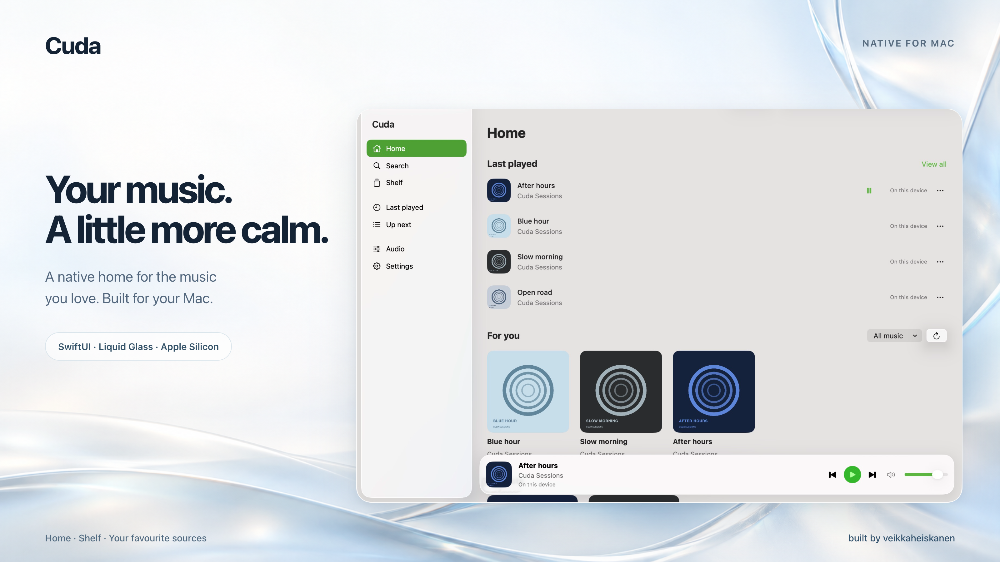
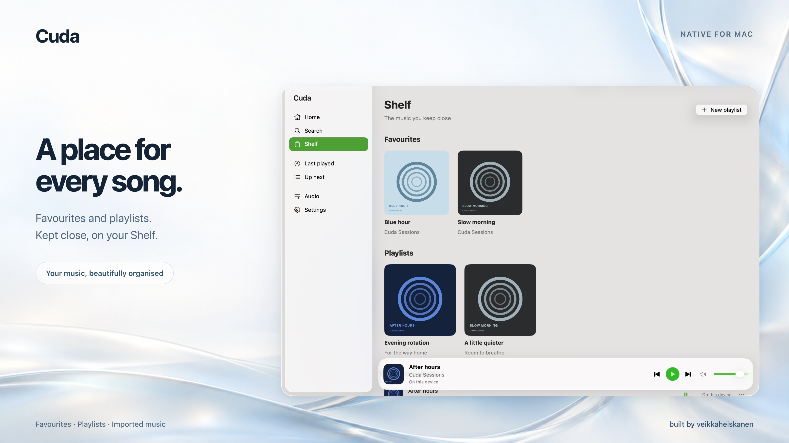
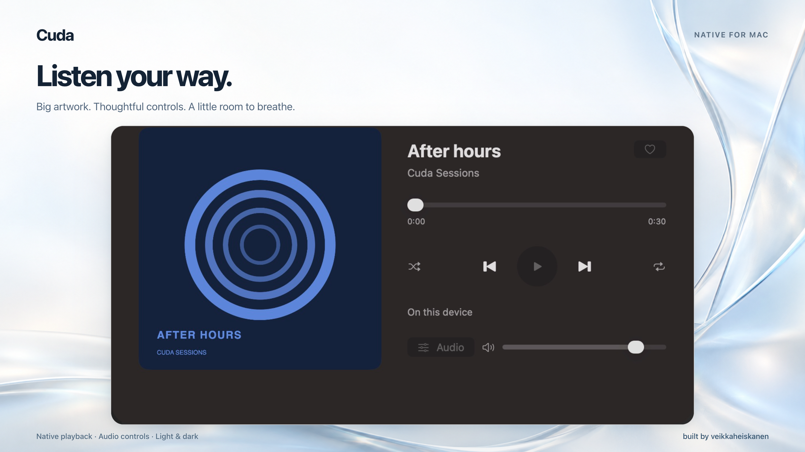
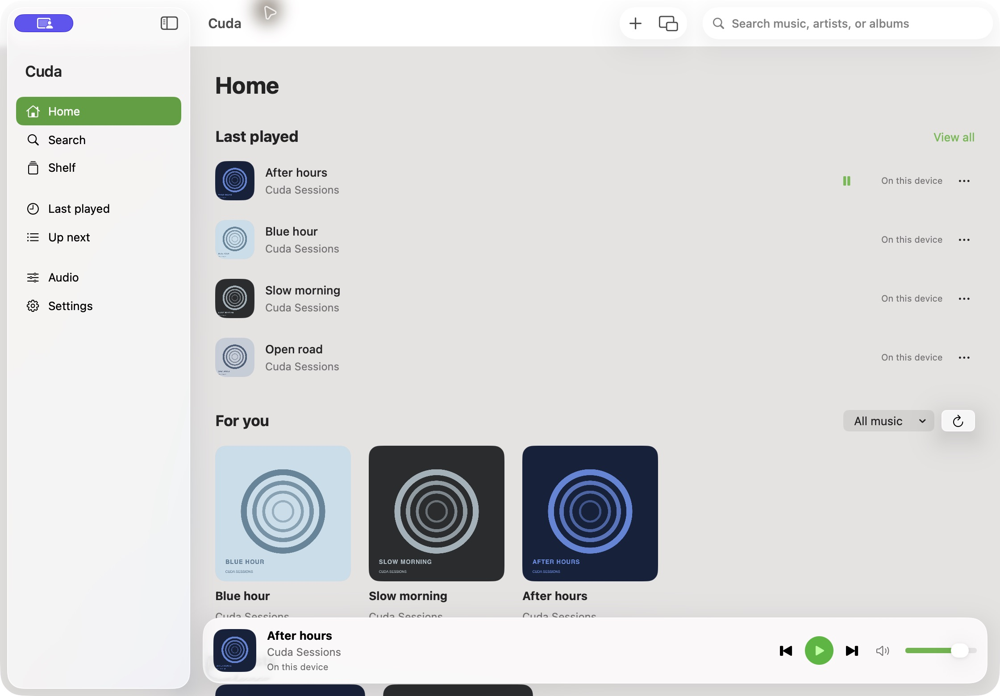
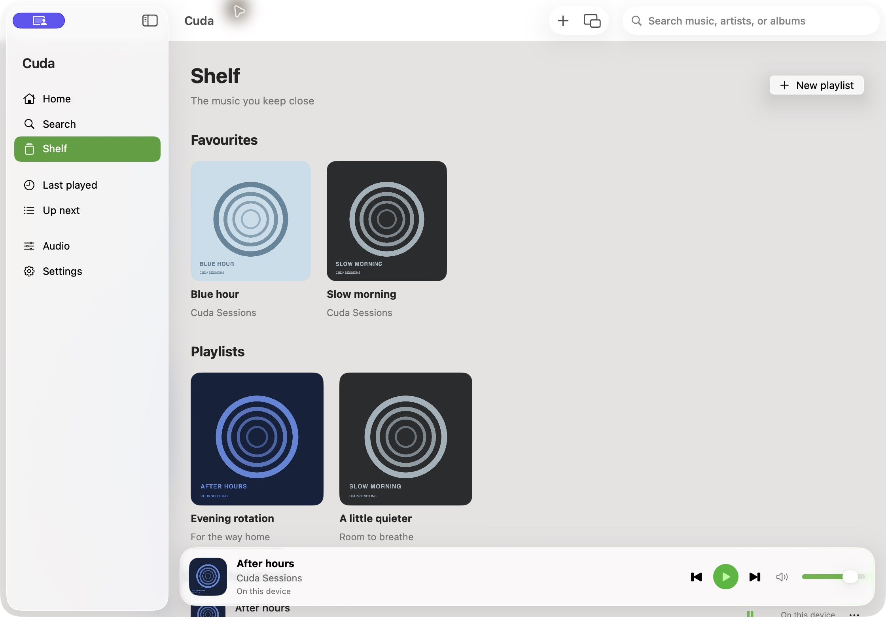
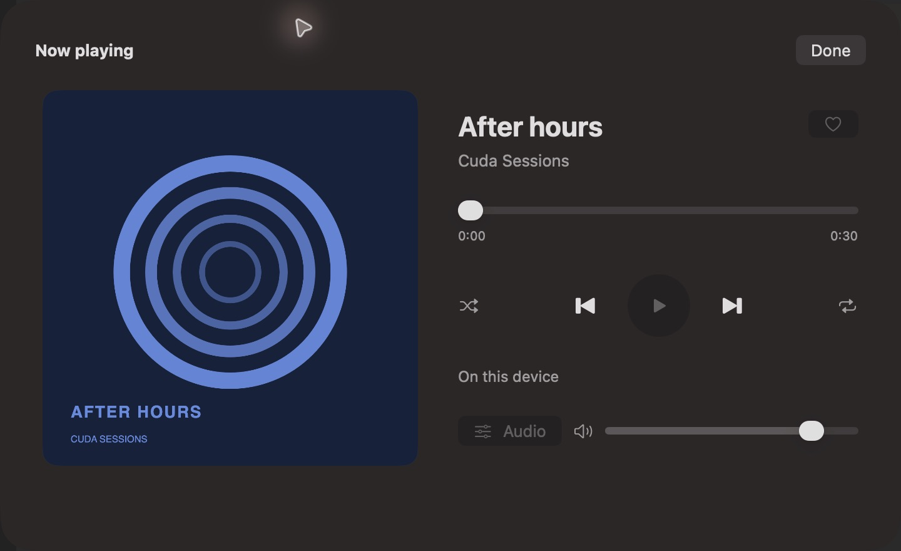
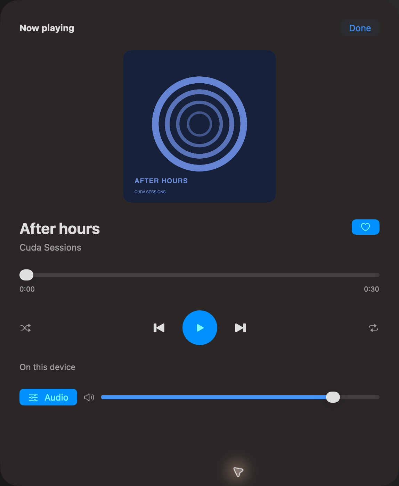

<p align="center">
  
</p>

# Cuda

**Your music. A little more calm.**

Cuda is a music player for Apple Silicon, built by [veikkaheiskanen](https://github.com/veikkaheiskanen). A native SwiftUI interface with Apple’s actual Liquid Glass brings Spotify, YouTube, YouTube Music, SoundCloud, and your own audio files into one place.

Built with help from ChatGPT

[Download for Mac](https://github.com/veikkaheiskanen/Cuda/releases/latest) · [Explore the app](#a-place-for-every-song) · [Build for Mac](#build-for-mac) · [Spotify setup](SPOTIFY.md) · [Report an issue](https://github.com/veikkaheiskanen/Cuda/issues)

## A place for every song

- **Home, made personal.** Recommendations, recently played music, and playlists are always close by. Connected Spotify playlists help shape what appears next.
- **Your Shelf.** Favourites and playlists live together in two easy-to-browse artwork rows. Create a mix, edit its name and description, and add songs without duplicates.
- **Listen your way.** Auto races matching sources and uses the first ready stream. Prefer a particular service? Choose it from the player's source menu.
- **A quieter player.** The compact bar keeps the song and essential controls in view. Open it for large artwork, seeking, shuffle, repeat, volume, and audio settings.
- **Sound with room to adjust.** Equalizer, presets, and sound controls work with local and public audio, plus Cuda's native Spotify player.
- **Comfortable on your Mac.** Light, dark, and system appearance; adjustable window transparency; native traffic lights; keyboard shortcuts; and an adaptive layout for narrow windows.

<p align="center">
  
</p>

<p align="center">
  
</p>

*Promo images combine actual native Mac app screens with an illustrative Cuda Sessions library, original demo artwork, and a generated glass background. [Image details](docs/promo/README.md).*

<details>
<summary>View the original native app screenshots</summary>






The narrow layout is a resized desktop window.

</details>

## Build for Mac

Cuda targets native **arm64**, including Apple M5. Use an Apple Silicon Mac running **macOS 26 or later**, Node.js 24, Rust, and Apple’s current Command Line Tools or Xcode.

```sh
git clone https://github.com/veikkaheiskanen/Cuda.git
cd Cuda
npm ci --prefix macos --omit=dev
npm test
npm run build:mac
```

The build compiles SwiftUI/AppKit, the Rust Spotify player, and a network audio decoder, then packages verified media tools and a private source resolver into `dist/Cuda.app`. The app contains no Electron, Chromium, or web view. No Homebrew audio tools or Rosetta are required. Read the [native Mac guide](macos/README.md) for architecture, migration, and verification.

Open the DMG and drag **Cuda** into **Applications**. Local builds are ad-hoc signed and are not Apple-notarized; downloaded copies may need **Open Anyway** in macOS Privacy & Security. See the [native Mac guide](macos/README.md) for distribution and packaged-app checks.

## Connect Spotify

Open **Settings → Spotify**. Connect your library with a registered Spotify app Client ID, select the playlists you want to use for recommendations, then choose **Connect playback** for the native player. Spotify playback requires Premium. Your Cuda favourites remain saved locally even if Spotify library sync is unavailable.

Read [SPOTIFY.md](SPOTIFY.md) for setup, account requirements, radio, album browsing, and weekly picks. Service availability and streaming start times depend on the provider and network.

## Development

```sh
npm start                 # Run the desktop app
npm test                  # Regression tests
npm run build:mac          # Build the native SwiftUI app
npm run start:legacy       # Run the previous Electron interface
```

Native Mac code and audio checks live in `macos/`; Spotify playback lives in `native/spotify-player/`. Tests use isolated profiles and generated audio fixtures. See the native guide for source migration and current feature limits.

The Mac app uses SwiftUI’s system `glassEffect` and glass controls on macOS 26. AppKit manages real window geometry; there are no CSS corner masks or simulated traffic lights. The previous Electron interface remains in the repository as a legacy fallback and is not included in the native app.

## Powered on

- [**Riff by rootless**](https://github.com/rootscripts/riff) — the foundation of Cuda.
- [**Deck by jarilehtinen**](https://github.com/jarilehtinen/deck) — inspiration and credited source for Spotify features.

Cuda Native uses SwiftUI, AppKit, AVFoundation, a private Node resolver, librespot, FFmpeg, and yt-dlp. HLS.js, Tone.js, and Electron belong to the legacy interface. Native vendor code and redistributed tools retain their own license notices. See [LICENSE](LICENSE), [native/DECK-LICENSE](native/DECK-LICENSE), and the bundled third-party notices.

## Cuda for iOS

The native iPhone and iPad port lives in [ios/](ios/README.md). It supports local audio, Spotify through the official iOS SDK, and public streams through a paired Mac companion. The iOS workflow builds an unsigned IPA for signing and sideloading with your own Apple account. See the iOS guide for source requirements and features.
